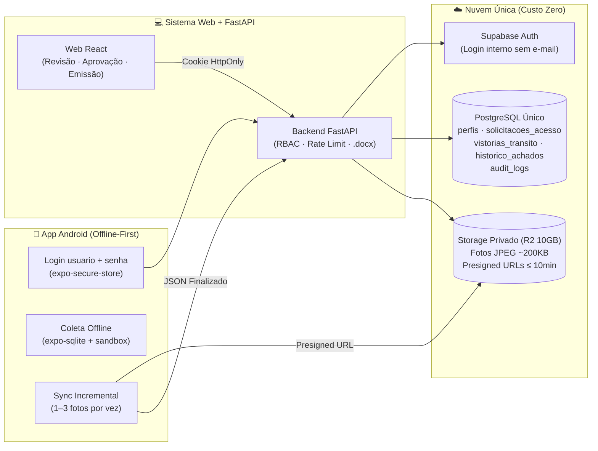

# Arquitetura de Banco de Dados, Integração Mobile ↔ Web, Perfis (RBAC) e Segurança

> **Autoria:** Tech Lead Analyst · Ecossistema **Gerador de Relatórios ARPE**
> **Escopo:** Integração entre o **App Android Offline-First** (`arpe-relatorios-mobile`) e o **Sistema Web + Backend FastAPI** (repositório separado — Polyrepo).
> **Premissas Reais:** Sistema fechado corporativo (até 10 usuários), **sem uso de e-mail**, 3 perfis (`adm`, `coordenador`, `analista`), volume real de até **40 vistorias simultâneas** com média de **≤ 50 fotos** por vistoria, 6 modalidades regulatórias (`CRA`, `CRC`, `SOCICAM` × `Fiscalização`, `Monitoramento`), **Custo Zero (Free Tier)** e conformidade estrita com **OWASP** e **LGPD (Lei nº 13.709/2018)**.

---

## 1. Decisão Arquitetural: Quantos Bancos de Dados Usar?

### Comparativo de Opções

| Opção | Arquitetura | Viabilidade | Parecer Técnico |
| :--- | :--- | :---: | :--- |
| **Opção A (ESCOLHIDA)** | **1 Banco PostgreSQL** (Supabase Free 500 MB) + **1 Object Storage Privado** (Cloudflare R2 10 GB Free ou Supabase Storage Privado) | **Máxima · Custo Zero** | ✅ Unifica integridade referencial, **RLS** nativo por perfil e custo zero com folga operacional |
| **Opção B** | 2 bancos separados (Usuários em um, Vistorias em outro) | Baixa | ❌ Quebra `FOREIGN KEY` e impede **Row Level Security (`RLS`)** ligando `auth.uid()` + `role` às vistorias; consome o limite de projetos gratuitos |
| **Opção C** | 4 bancos (Usuários + Fiscalização + Monitoramento + Histórico) | Inviável | ❌ *Anti-pattern* de banco de dados: duplica estrutura, complica relatórios consolidados e multiplica superfície de ataque |

### Por que 1 único PostgreSQL + 1 Object Storage Privado é a escolha ideal?
1. **Separação lógica por tabelas (e não por bancos):** No PostgreSQL, `Fiscalização` e `Monitoramento` compartilham 90% dos atributos e são distinguidos por uma coluna tipada `modalidade ('Fiscalização' | 'Monitoramento')` com índice, permitindo consultas rápidas, integridade referencial e gráficos consolidados.
2. **Fotos NUNCA vão dentro do PostgreSQL:** Salvar binários (`BYTEA` / `Base64`) no banco estouraria os 500 MB e degradaria queries. As fotos vão para o **Object Storage Privado**, enquanto o PostgreSQL guarda apenas o JSON estruturado da vistoria e as chaves dos arquivos.

---

## 2. Fotos: `.ZIP` vs. Fotos Comprimidas Individuais & Retenção

### Por que fotos JPEG individuais (~200 KB) vencem `.ZIP`?
* **Resiliência em 4G instável:** Com `.ZIP` único (~10–20 MB), uma queda de sinal em 90% obriga a reenviar tudo do zero. Com fotos individuais (~200 KB, máx. 1600px, JPEG 80% via `expo-image-manipulator`), o motor envia **1 a 3 fotos por vez** e retoma exatamente da próxima foto se o sinal cair.
* **Memória RAM no Android:** Compactar 50–100 fotos em `.ZIP` dentro do celular eleva risco de *Out-Of-Memory (OOM)*.
* **Agilidade no Web:** O analista visualiza as fotos sob demanda via **Presigned URLs** privadas sem precisar baixar e descompactar um pacote inteiro; na hora de gerar o `.docx`, o FastAPI baixa as fotos da vistoria em paralelo e compila o documento.

### Dimensionamento Real vs. Governança LGPD
* **Capacidade Técnica (Folga Enorme):**
  * Cenário de pico informado: **40 vistorias simultâneas × 50 fotos × ~200 KB ≈ 400 MB**.
  * No **Cloudflare R2 Free (10 GB, egresso gratuito)**, 400 MB representam **apenas 4% do limite gratuito** — ou seja, tecnicamente não há risco de lotação operacional.
* **Recomendação Obrigatória de LGPD (Temporalidade — Art. 6º e Art. 15):**
  * Embora o espaço comporte com folga, **manter fotos de campo indefinidamente na nuvem viola o princípio da necessidade da LGPD** (pois fotos de terminais/rodovias podem captar transeuntes ou placas).
  * **Solução equilibrada:**
    1. **Não apagar durante a revisão:** as fotos permanecem disponíveis enquanto a vistoria estiver em `Finalizados` / em revisão no Web.
    2. **Expurgo controlado pós-emissão do `.docx`:** após a emissão oficial do `.docx` (e confirmação/arquivamento pelo analista ou coordenador), as fotos temporárias daquela vistoria são removidas do Storage, mantendo **permanentemente** no PostgreSQL (`historico_achados`) **apenas os metadados estruturados de NCs e PAs (sem fotos e sem dados pessoais)** para gráficos de meses/anos.
    3. **Painel de limpeza para `ADM`:** botão de limpeza manual de vistorias já emitidas + política opcional de expiração (ex.: 30 dias após emissão).

---

## 3. Modelo de Usuários Sem E-mail, Aprovação por `ADM` ou `Coordenador` e Blindagem do `ADM`

### 3.1. Sistema Fechado Sem E-mail Corporativo/Pessoal
Para eliminar exposição de e-mails pessoais e manter o sistema 100% fechado à equipe interna:
* O usuário autentica exclusivamente com **`usuario` (login interno — ex.: `pedro.souza`, `ctr01`) + `senha`**.
* **Compatibilidade transparente com Supabase Auth:** Como o Supabase Auth exige internamente um campo `email`, o Backend FastAPI converte de forma invisível `usuario` → `${usuario.toLowerCase()}@arpe.internal` (domínio sintético não-roteável, nunca exibido na interface, sem disparo de e-mails externos).

### 3.2. Fluxo de Solicitação de Conta com Aprovação Individual (`ADM` ou `Coordenador`)
* **Auto-cadastro direto DESABILITADO.** Nenhuma conta entra ativa automaticamente.
* **Fluxo:**
  1. Na tela de login (App ou Web), existe o link discreto **"Solicitar Acesso"**.
  2. O solicitante informa: `nome_completo`, `usuario` desejado, `perfil_solicitado` (**apenas `analista` ou `coordenador`** — **NUNCA é possível solicitar `adm`**) e define uma senha forte.
  3. O registro nasce em `solicitacoes_acesso` com:
     * `status = 'pendente'`
     * `decidido_por = NULL`
     * `senha_hash_temp` (Argon2id/bcrypt no servidor; nunca em texto puro).
  4. **Regra de Aprovação Individual:** Basta a aprovação de **um** gestor autorizado (**`ADM` OU `Coordenador`**) para criar imediatamente o usuário no `auth.users` + `perfis` (`ativo = true`), descartar `senha_hash_temp` e registrar em `audit_logs` exatamente quem aprovou ou rejeitou. *(O perfil `adm` continua exclusivo de criação via servidor.)*

### 3.3. Matriz de Permissões (`RBAC`)

| Ação | `analista` | `coordenador` | `adm` |
| :--- | :---: | :---: | :---: |
| Coletar e finalizar vistorias no App Android | ✅ | ✅ | ✅ |
| Ver e gerar `.docx` das vistorias finalizadas no Web | ✅ *(próprias/equipe)* | ✅ *(todas)* | ✅ *(todas)* |
| Aprovar/Rejeitar solicitação de acesso (individual) | ❌ | ✅ | ✅ |
| Desativar contas / Resetar senha / Ver `audit_logs` | ❌ | ❌ | ✅ |
| Promover ou criar outro `adm` | ❌ | ❌ | ⚠️ **Apenas via CLI/Script no servidor** |

### 3.4. Blindagem Especial da Conta `ADM` (Camadas de Proteção)
A conta `ADM` possui o maior privilégio do ecossistema e deve obedecer a **6 travas bloqueantes**:
1. **Criação Exclusivamente Offline/Servidor (Bootstrap Seed):** A conta `ADM` **não pode** ser criada por nenhuma rota HTTP pública nem solicitada pela tela de cadastro. É criada apenas via script administrativo executado diretamente no servidor/Supabase com `SERVICE_ROLE_KEY`.
2. **Trigger SQL Anti-Escalação de Privilégio:** Trigger `BEFORE UPDATE` na tabela `perfis` bloqueia no nível do banco de dados qualquer tentativa de alterar `role` para `'adm'` por sessões comuns e impede desativar ou excluir o último `ADM` ativo.
3. **Política de Senha Forte + Bloqueio Progressivo (Anti-Brute-Force):**
   * `ADM`: mínimo **12 caracteres** (maiúscula, minúscula, número e símbolo). Demais perfis: mínimo **10 caracteres**.
   * **Account Lockout:** após **5 tentativas falhas** de login, a conta bloqueia automaticamente por **15 minutos** (com registro imediato em `audit_logs`) + *rate limiting* por IP no FastAPI.
4. **Sessão Curta + Revogação Instantânea:** Access Token JWT com validade curta (**15 minutos**) e Refresh Token rotativo armazenado de forma segura (`expo-secure-store` no Android; cookie `HttpOnly + Secure + SameSite=Strict` no Web). Em caso de perda de celular, o `ADM` revoga a sessão em 1 clique.
5. **Reconfirmação de Senha para Ações Críticas do `ADM`:** Aprovar conta, desativar usuário, resetar senha ou expurgar lote exige redigitar a senha do `ADM` (ou PIN secundário) para neutralizar sequestro de sessão em computador destravado.
6. **Auditoria Imutável (`audit_logs`):** Tabela *append-only* (RLS permite apenas `INSERT` pelo backend e `SELECT` pelo `ADM`; `UPDATE` e `DELETE` proibidos para todos) registrando `ator_id`, `acao`, `alvo`, `ip`, `user_agent` e `criado_em`.

---

## 4. Proteção Específica do Sistema Web (OWASP Top 10)

Como aplicações Web têm maior superfície de exposição que apps nativos:
* **Contra XSS (Roubo de Token):** Não guardar JWT em `localStorage` no Web; autenticar via Backend FastAPI emitindo cookies `HttpOnly; Secure; SameSite=Strict` + cabeçalhos `Content-Security-Policy (CSP)`, `X-Content-Type-Options: nosniff` e `X-Frame-Options: DENY`.
* **Contra CSRF:** `SameSite=Strict` + validação de cabeçalho `Origin`/`Referer` no FastAPI contra a lista fechada `ALLOWED_ORIGINS`.
* **Contra SQL Injection & Mass Assignment:** 100% queries parametrizadas (Pydantic schemas estritos no FastAPI; parâmetros `?` no `expo-sqlite`) + **RLS** habilitado em 100% das tabelas do PostgreSQL.
* **Contra Upload Malicioso:** Backend valida *magic bytes* (somente JPEG real `FF D8 FF`), tamanho máximo (`≤ 500 KB`), gera nome de arquivo sanitizado (UUID/padrão interno, nunca nome enviado pelo cliente) e emite Presigned URL com validade `≤ 10 min`.
* **Zero Segredos no Cliente:** `SUPABASE_SERVICE_ROLE_KEY`, chaves R2 e segredos JWT residem **exclusivamente** nas variáveis de ambiente do Backend FastAPI.
