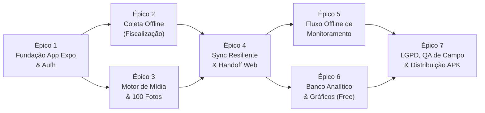

# Plano Geral de Épicos & Histórias de Usuário — App Android Offline-First (ARPE)

> **Base Arquitetural:** [.agents/AGENTS.md](../.agents/AGENTS.md) (React Native + Expo em repositório separado/à parte, `src/domain/` puro espelhando o contrato do Web, Offline-First com `expo-sqlite` + `expo-file-system`, Nuvem Free Tier em 2 camadas: Storage Temporário com TTL + PostgreSQL Analítico Permanente).
>
> **Objetivo deste documento:** Visão macro em **Épicos** e **Histórias de Usuário** priorizadas por valor para guiar o desenvolvimento incremental e organizado do App Android sem perder o escopo.

---

## Mapa de Dependências & Ondas de Entrega

* **Marco 1 (MVP de Campo — Épicos 1 a 4):** Fiscal já coleta **Fiscalização** 100% offline no Android, sincroniza fotos comprimidas para a nuvem temporária e finaliza o `.docx` no Web.
* **Marco 2 (Ciclo Regulatório Completo — Épicos 5 e 6):** Suporte completo a **Monitoramento** (com pré-carga offline do relatório anterior) + gravação permanente de NCs/PAs no banco analítico para gráficos de meses/anos.
* **Marco 3 (Produção Controlada — Épico 7):** Blindagem LGPD, testes de estresse com 100 fotos em Modo Avião e entrega do `.apk` para os até 10 usuários.

---

## Épico 1 — Fundação do App Independente (Expo), Domínio Local e Acesso Seguro
**Objetivo:** Criar o repositório próprio do App Android (`arpe-relatorios-mobile`), estruturar `src/domain/` espelhando os contratos oficiais dos 6 estados do Web e autenticar os até 10 usuários da ARPE.

### Histórias de Usuário
* **US-1.1 — Bootstrap Expo e Camada de Domínio (`src/domain/`):** *Como desenvolvedor, quero criar o projeto React Native + Expo em repositório separado com a camada pura `src/domain/` (tipos `FiscalizacaoItem`, `RegistroNcItem`, codificação `CRA`, normalização `SOCICAM` e estatísticas compatíveis com o contrato JSON do Web), para manter código Web e Mobile totalmente isolados e limpos.*
* **US-1.2 — Login e Sessão Offline:** *Como fiscal da ARPE, quero fazer login com minha conta institucional (Supabase Auth) e permanecer autenticado mesmo quando perder o sinal em campo, para acessar o app sem bloqueios na rodovia ou terminal.*
* **US-1.3 — Catálogos Sincronizados:** *Como fiscal, quero que o app baixe e armazene localmente os catálogos oficiais (responsáveis, coordenadores, contratos, NCs padrão e terminais SOCICAM) sempre que estiver online, para preencher vistorias offline sem digitar tudo manualmente.*

---

## Épico 2 — Coleta Rápida Offline em Campo (Fiscalização — 3 Concessões)
**Objetivo:** Permitir que o fiscal crie vistorias e cadastre NCs/PAs no Android com uma mão, 100% offline, adaptando os campos automaticamente para `CRA`, `CRC` e `SOCICAM`.

### Histórias de Usuário
* **US-2.1 — Abertura de Vistoria Offline:** *Como fiscal, quero escolher a concessão (`CRA`, `CRC` ou `SOCICAM`), iniciar uma nova Fiscalização offline e salvar os dados básicos no `expo-sqlite`, para começar o trabalho imediatamente em campo.*
* **US-2.2 — Formulário Adaptativo por Concessão:** *Como fiscal, quero que o app exiba `Pista/Faixa/Trecho/Estaca` em CRA/CRC e **nunca** exiba pista/faixa em SOCICAM (exibindo `Terminal` e setores prediais), para evitar erros de preenchimento regulatório.*
* **US-2.3 — Codificação Automática e Rascunho Persistente:** *Como fiscal, quero que a codificação CRA (`CRA.ST...`) seja sugerida automaticamente e que o app salve cada ocorrência instantaneamente no banco local, para nunca perder dados se a bateria acabar ou o app fechar.*

---

## Épico 3 — Motor de Mídia Local e Performance para até 100 Fotos
**Objetivo:** Garantir captura rápida, compressão local leve (~200 KB) e estabilidade de memória no Android mesmo em vistorias grandes (até 100 fotos).

### Histórias de Usuário
* **US-3.1 — Captura Contínua no Sandbox Privado:** *Como fiscal, quero tirar fotos diretamente pelo app (ou importar da galeria quando necessário) salvando-as no diretório privado do app (`expo-file-system`), para que as fotos de trabalho não se misturem à minha galeria pessoal (LGPD).*
* **US-3.2 — Compressão Automática em Campo:** *Como sistema, quero redimensionar e comprimir cada foto localmente (`1600px`, JPEG 80% ≈ 200 KB) no momento da captura, para economizar espaço no aparelho e viabilizar o envio de 100 fotos no 4G.*
* **US-3.3 — Galeria Leve e Relacionamento de Fotos:** *Como fiscal, quero visualizar as miniaturas das fotos da vistoria com fluidez (sem travar com 100 fotos) e relacionar múltiplas fotos à mesma NC/PA, para registrar evidências completas sem lentidão.*

---

## Épico 4 — Fila de Sincronização Resiliente e Handoff Temporário para o Web
**Objetivo:** Sincronizar vistorias e fotos comprimidas automaticamente quando houver internet, com retomada em caso de queda de sinal, e permitir que o Web importe a coleta para gerar o `.docx`.

### Histórias de Usuário
* **US-4.1 — Fila de Upload Foto a Foto com Retomada:** *Como fiscal, quero acompanhar o progresso do envio (`ex.: 67/100 fotos enviadas`) e ter certeza de que, se a internet cair, o app retomará automaticamente da foto 68 quando o sinal voltar, sem reenviar nem duplicar fotos.*
* **US-4.2 — Importação no Aplicativo Web:** *Como analista no escritório, quero clicar em "Importar Vistoria do Campo" no site Web, visualizar as coletas sincronizadas pelo Android e carregar todos os registros e fotos diretamente na minha sessão, para revisar e gerar o relatório `.docx` no FastAPI.*
* **US-4.3 — Expurgo Pós-Emissão e TTL Automático:** *Como gestor do sistema, quero que as fotos temporárias na nuvem sejam apagadas automaticamente após a emissão confirmada do `.docx` no Web (e tenham expiração máxima de 15 dias por regra de bucket), para manter o custo em R$ 0 (Free Tier) e cumprir a LGPD.*

---

## Épico 5 — Fluxo Completo Offline de Monitoramento (CRA, CRC e SOCICAM)
**Objetivo:** Permitir que o fiscal realize vistorias de Monitoramento offline em campo, comparando o achado anterior com a situação atual.

### Histórias de Usuário
* **US-5.1 — Pré-Carga Offline do Relatório Anterior:** *Como fiscal, quero baixar no celular (antes de sair para campo) a lista de NCs pendentes e miniaturas das fotos do relatório anterior de um processo, para auditar cada pendência sem precisar de internet no local.*
* **US-5.2 — Auditoria Comparativa em Campo:** *Como fiscal, quero abrir cada NC anterior no celular, ver a foto/descrição antiga lado a lado, tirar a nova foto comprobatória e marcar `Sanada`, `Parcialmente Sanada` ou `Pendente` com `Constatação`, `Posicionamento/Informação` e `Análise ARPE`, para agilizar o monitoramento.*
* **US-5.3 — Recomendações Gerais (SOCICAM Monitoramento):** *Como fiscal, quero visualizar no celular um resumo rápido de quantas NCs foram sanadas/pendentes e opcionalmente rascunhar `Recomendações à SOCICAM`, para que o Web já receba a Etapa 04 pré-preenchida.*

---

## Épico 6 — Banco Analítico Permanente (Free) e Gráficos Históricos no Web
**Objetivo:** Construir a memória histórica de longo prazo (meses/anos) armazenando apenas NCs e PAs estruturadas (sem fotos), habilitando painéis gerenciais no Web.

### Histórias de Usuário
* **US-6.1 — Gravação Enxuta no Banco Permanente:** *Como analista, quero que, ao finalizar um relatório no Web, o sistema grave apenas os metadados das NCs e PAs (`concessão`, `modalidade`, `data`, `local/trecho`, `tipo`, `categoria`, `situação`) no PostgreSQL permanente, para acumular anos de dados dentro do Free Tier.*
* **US-6.2 — Dashboard Histórico por Período e Concessão:** *Como coordenador da ARPE, quero filtrar por concessão (`CRA`, `CRC`, `SOCICAM`), período (mês/ano) e terminal/trecho para visualizar gráficos de evolução de NCs abertas, taxa de saneamento e categorias mais recorrentes, para apoiar decisões regulatórias.*

---

## Épico 7 — Blindagem LGPD, Testes de Campo e Distribuição Interna (.apk)
**Objetivo:** Garantir confiabilidade real antes de colocar o app na mão dos fiscais em campo.

### Histórias de Usuário
* **US-7.1 — Controle de Acesso e Segurança (LGPD):** *Como gestor, quero validar que todas as rotas exigem JWT, que o bucket temporário é 100% privado (Presigned URLs), que o banco analítico não guarda dados pessoais e que o CORS de produção está restrito, para operar com segurança jurídica.*
* **US-7.2 — Teste de Estresse Offline (100 Fotos + Queda de Rede):** *Como QA/Tech Lead, quero validar o ciclo completo em um Android real (Modo Avião → 100 fotos → fechar app → reabrir → religar rede → interromper no meio → finalizar no Web), para garantir zero perda de dados em campo.*
* **US-7.3 — Build e Distribuição Controlada (EAS Build):** *Como equipe técnica, quero gerar `.apk` assinado via Expo EAS Build e distribuir internamente para os até 10 fiscais com versionamento claro, para facilitar atualizações sem burocracia da Play Store pública.*

---

## Resumo de Priorização Recomendada

| Ordem | Épico | Entregável Concreto |
| :---: | :--- | :--- |
| **1º** | Épico 1 (App Expo Independente + Auth) | Repositório mobile com `src/domain/` + login funcionando |
| **2º** | Épico 2 + Épico 3 (Fiscalização Offline + Motor 100 Fotos) | Coleta offline completa no Android com compressão local |
| **3º** | Épico 4 (Sync + Handoff Web + Expurgo) | **MVP utilizável em campo** gerando `.docx` real no Web |
| **4º** | Épico 5 (Monitoramento Offline) | Cobertura completa dos **6 estados regulatórios** no Android |
| **5º** | Épico 6 (Banco Analítico + Gráficos) | Inteligência histórica de meses/anos no Free Tier |
| **6º** | Épico 7 (LGPD + Estresse + APK) | Liberação oficial para os até 10 usuários da ARPE |

